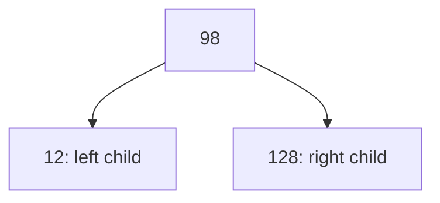

# C - Binary Trees

This Holberton School project implements binary-tree operations in C. The
exercises cover creating and linking nodes, traversing a tree, measuring its
shape, checking structural properties, finding relatives, and freeing memory.

The repository contains 19 numbered implementation files and a shared header.
There is no included `main` program; callers build a tree and choose which
functions to use.

## Node structure

[`binary_trees.h`](binary_trees.h) defines `binary_tree_t`, an alias for
`struct binary_tree_s`. Each node stores:

| Field | Purpose |
| --- | --- |
| `n` | Integer value |
| `parent` | Parent node, or `NULL` for a root |
| `left` | Left child, or `NULL` |
| `right` | Right child, or `NULL` |

These are general binary trees. Insertion does not compare values, enforce
binary-search-tree ordering, or rebalance the tree.

## Functions

| Source | What it does |
| --- | --- |
| [`0-binary_tree_node.c`](0-binary_tree_node.c) | Allocates a node with its value and parent pointer, leaving both children null; returns `NULL` on allocation failure |
| [`1-binary_tree_insert_left.c`](1-binary_tree_insert_left.c) | Inserts a left child; an existing left child becomes the new node's left child |
| [`2-binary_tree_insert_right.c`](2-binary_tree_insert_right.c) | Inserts a right child; an existing right child becomes the new node's right child |
| [`3-binary_tree_delete.c`](3-binary_tree_delete.c) | Recursively frees a tree, releasing children before their parent |
| [`4-binary_tree_is_leaf.c`](4-binary_tree_is_leaf.c) | Returns `1` when a non-null node has no children, otherwise `0` |
| [`5-binary_tree_is_root.c`](5-binary_tree_is_root.c) | Returns `1` when a non-null node has no parent, otherwise `0` |
| [`6-binary_tree_preorder.c`](6-binary_tree_preorder.c) | Calls a supplied function in root, left, right order |
| [`7-binary_tree_inorder.c`](7-binary_tree_inorder.c) | Calls a supplied function in left, root, right order |
| [`8-binary_tree_postorder.c`](8-binary_tree_postorder.c) | Calls a supplied function in left, right, root order |
| [`9-binary_tree_height.c`](9-binary_tree_height.c) | Measures the longest downward path in edges; a leaf has height `0` |
| [`10-binary_tree_depth.c`](10-binary_tree_depth.c) | Counts parent links up to the root; a root has depth `0` |
| [`11-binary_tree_size.c`](11-binary_tree_size.c) | Counts all nodes in a tree |
| [`12-binary_tree_leaves.c`](12-binary_tree_leaves.c) | Counts nodes with no children |
| [`13-binary_tree_nodes.c`](13-binary_tree_nodes.c) | Counts nodes with at least one child |
| [`14-binary_tree_balance.c`](14-binary_tree_balance.c) | Returns left-subtree height minus right-subtree height using its internal height helper |
| [`15-binary_tree_is_full.c`](15-binary_tree_is_full.c) | Checks that every node has either zero or two children |
| [`16-binary_tree_is_perfect.c`](16-binary_tree_is_perfect.c) | Checks that internal nodes have two children and all leaves are at the same depth |
| [`17-binary_tree_sibling.c`](17-binary_tree_sibling.c) | Returns the other child of a node's parent, or `NULL` if absent |
| [`18-binary_tree_uncle.c`](18-binary_tree_uncle.c) | Returns the sibling of a node's parent, or `NULL` if absent |

## Requirements

- Correction environment: Ubuntu 20.04 LTS using GCC.
- Required compiler options: `-Wall -Werror -Wextra -pedantic -std=gnu89`.
- Code must follow Betty style, checked with
  [`betty-style.pl`](https://github.com/hs-hq/Betty/blob/master/betty-style.pl)
  and [`betty-doc.pl`](https://github.com/hs-hq/Betty/blob/master/betty-doc.pl).

## Build

From the repository root, check all implementations without creating object
files:

```bash
gcc -Wall -Werror -Wextra -pedantic -std=gnu89 -fsyntax-only *.c
```

To run the functions, supply a caller containing `main` and link the needed
implementation files. The example below links all numbered exercises together.
No external tree-printing helper is required.

## Betty checks

With Betty installed and its commands on your `PATH`, run:

```bash
betty-style *.c binary_trees.h
betty-doc *.c binary_trees.h
```

The 19 implementation files and header pass the installed style and
documentation checkers locally.

## Usage

Save this caller as `main.c` in the repository root:

```c
#include "binary_trees.h"
#include <stdio.h>

/**
 * print_value - Prints one node value
 * @value: Integer stored in the node
 */
static void print_value(int value)
{
	printf("%d\n", value);
}

/**
 * main - Builds, traverses, measures, and frees an example tree
 *
 * Return: 0 on success, 1 on allocation failure
 */
int main(void)
{
	binary_tree_t *root;

	root = binary_tree_node(NULL, 98);
	if (root == NULL)
		return (1);
	if (binary_tree_insert_left(root, 12) == NULL ||
		binary_tree_insert_right(root, 128) == NULL)
	{
		binary_tree_delete(root);
		return (1);
	}
	binary_tree_preorder(root, print_value);
	printf("Height: %lu\n", (unsigned long)binary_tree_height(root));
	printf("Size: %lu\n", (unsigned long)binary_tree_size(root));
	binary_tree_delete(root);
	root = NULL;
	return (0);
}
```

The example creates this tree:



Compile and run:

```bash
gcc -Wall -Werror -Wextra -pedantic -std=gnu89 main.c [0-9]*.c -o tree_example
./tree_example
```

Output:

```text
98
12
128
Height: 1
Size: 3
```

For the same tree, in-order traversal visits `12, 98, 128`; post-order visits
`12, 128, 98`. It has two leaves, one node with children, balance factor `0`,
and is both full and perfect. In-order traversal only produces sorted values
when the tree itself satisfies binary-search-tree ordering.

## Ownership, conventions, and limits

- `binary_tree_node` sets the parent pointer but does not attach the new node
  to a parent's child field. Use the insertion helpers or link both directions
  yourself.
- Insertions return `NULL` for a null parent or allocation failure. When a
  child already exists, it is preserved below the inserted node and its parent
  pointer is updated.
- Traversals do nothing for a null tree or callback. Numeric measurements
  return `0` for null input. The full/perfect checks also return `0` for an
  empty tree; a single node is both full and perfect.
- A positive balance factor means the left subtree is taller; a negative
  value means the right subtree is taller. The helper distinguishes an empty
  child from a leaf even though the public height function returns `0` for both.
- `binary_tree_delete` frees all descendants but does not clear the caller's
  pointer or detach the tree from a surviving parent. Clear or detach those
  links in the caller before reusing the surrounding structure.
- Functions assume valid, acyclic links and consistent parent pointers. Deep
  trees can exhaust the stack during recursive operations. These exercises
  do not provide automatic balancing or protection against malformed links.

## Verification

All implementations compile locally with the required flags using GCC 15.2.0.
The README caller and its output were verified in temporary storage, along
with traversal order and the structural properties described above. Local
verification is separate from a correction run on Ubuntu 20.04 LTS.

## Clean up

Remove the executable created by the example when finished:

```bash
rm -f tree_example
```
